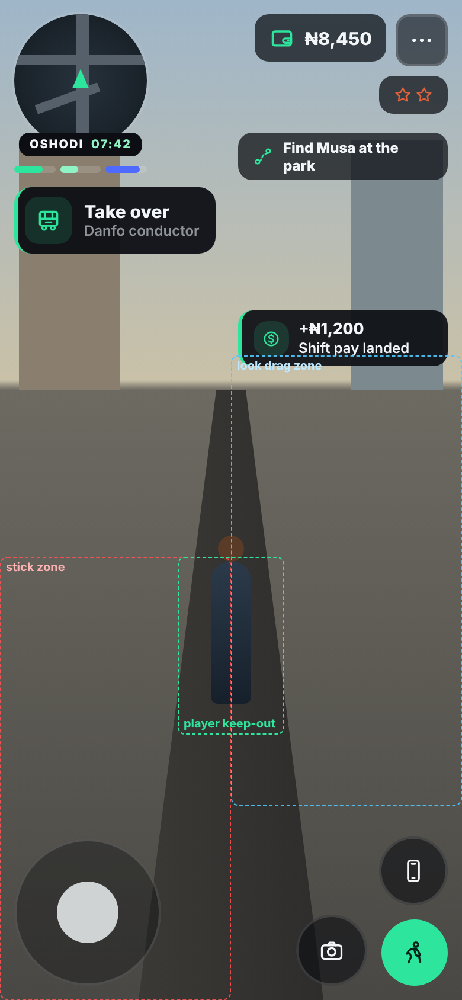
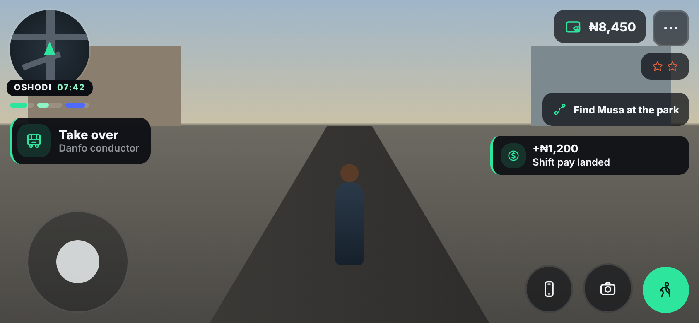
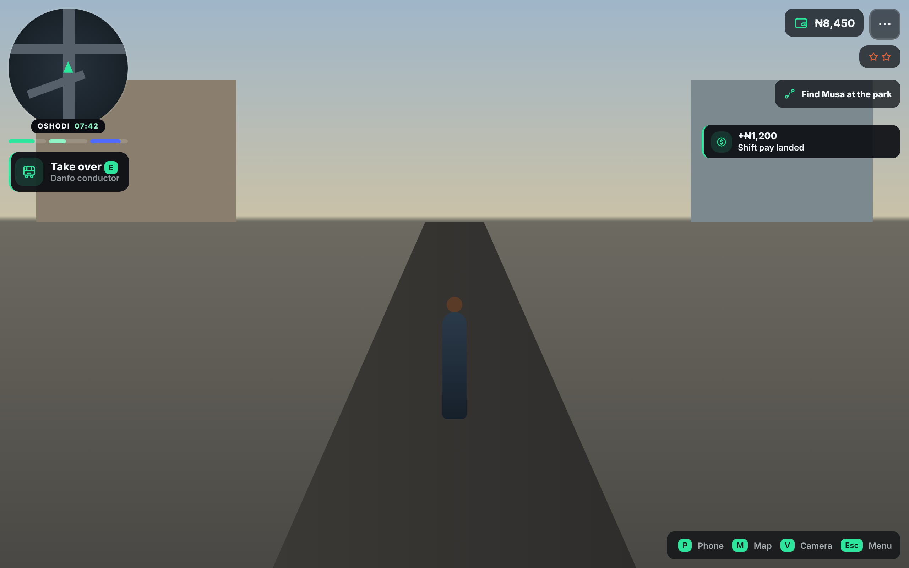
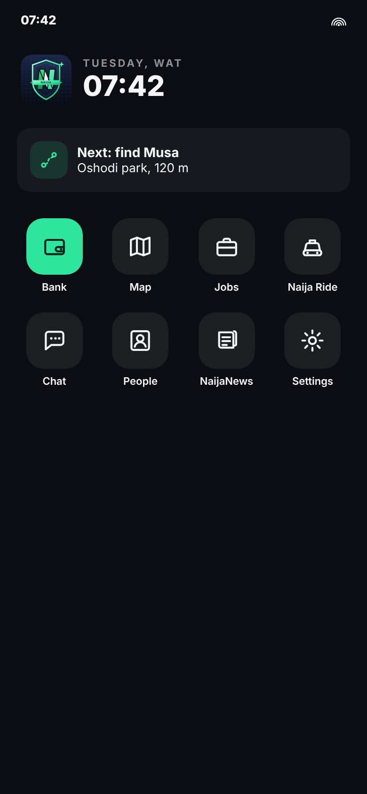
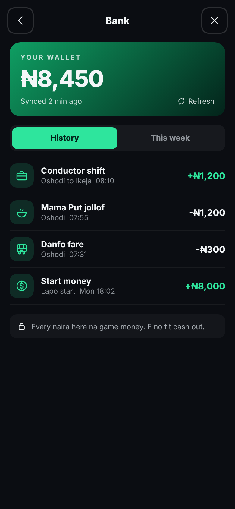

# Spec: HUD, touch controls, prompts and the phone (Unity)

**Owner:** Claude (UI, HUD and phone workstream). **Builders:** Ted's team.
**Status:** SPEC v1, 2026-11-05. Tasks HUD-1 to HUD-7 in `TASKS.md`.
**Sources:** `docs/DESIGN-INVENTORY.md` §9 (UI/HUD) and §2 (player),
`docs/MIGRATION-PLAN.md` §6 (M1, M6), the browser game's `css/nl-brand.css`
flat pro block and `js/nl-icons.js` (design only, no code carried over), and
Benjamin's UI rules listed in section 1.
**Milestone fit:** M1.6 (touch stick) and M6 (phone wallet from the server
ledger) depend on this spec. Nothing here may delay M1 or M2.

Mockups for the layout (drawn in a browser at real CSS pixel sizes; they are a
target, not a pixel contract):

| Phone portrait 390x844 | Phone landscape 844x390 | Desktop 1280x800 |
|---|---|---|
|  |  |  |

| Phone home | Bank (wallet) |
|---|---|
|  |  |

The dashed boxes on the portrait mockup are the stick zone (red), look drag
zone (blue) and player keep-out box (green). They are QA overlays, not UI.

---

## 1. Owner rules this spec must keep (hard rules)

These come from Benjamin. A build that breaks one is not done, whatever else
it does.

1. **Nothing blocks the screen.** Nothing fixed over the middle of the screen.
   No HUD piece, prompt, toast or button may ever cover the player or the
   joystick. (Design inventory §9; web handbook MU-1..7.)
2. **One action prompt at a time.** One prompt system, one slot. More offers
   become a "+N" chip, never a stack of buttons. (Inventory §9 Prompts.)
3. **Lean HUD, keep the minimap.** Benjamin likes the minimap and wants fewer
   icons (web, 2026-10-15). No button the player does not need right now.
   The camera button stays on the street (Benjamin asked for camera angles,
   2026-10-15).
4. **Pro GTA-quality UI** (Benjamin, 2026-10-17): designed panels, SVG-style
   line icons, never stock emoji, motion on every state change, no plain
   text dumps, no raw separators (`_`, `--`, `·`, em dashes) in player copy.
5. **No yellow or gold anywhere in UI** (Benjamin, 2026-10-28: "rebuild the
   ui to pro level games like gta", flat pro look). The accent is street
   green `#2EE59D`. This overrides the "gold gradient CTAs" line in design
   inventory §9, which predates that decision. World signs and real vehicle
   colours (yellow danfo) are not UI and stay.
6. **Brand reads as all of Nigeria**, not only Lagos. Name in player copy is
   **Naija Streets**. Logo is the esports shield mark in
   `Assets/UI/Brand/naija-life-mark.svg`; use the file, never redraw it.
7. **Mobile and laptop are both first class.** Every screen is checked at
   390x844, 844x390, 1280x800 and 1920x1080 before it counts.
8. **No hanging waits.** Pressed state at once, progress state within 300 ms,
   8 s timeout that ends in a friendly retry. Never a frozen button.
9. **No spam.** Toasts capped 3 live and 5 queued, deduped. Nothing
   interrupts play over and over.
10. **Every state you can tap into has a tappable way out** (exit prompt,
    back and close buttons, Esc on desktop).

## 2. Engine choice: UI Toolkit, not uGUI

**Decision:** all screen UI (HUD, touch controls, prompts, toasts, phone,
menus) is built with **UI Toolkit** (UXML + USS) on one runtime
`UIDocument`. uGUI is allowed only for world-space labels if UI Toolkit
world-space panels fail on WebGL (section 9).

**Why UI Toolkit:**

1. **The brand ports straight across.** USS has CSS-style variables, flexbox,
   border radius, transitions and `:hover`/`:active` states. The browser
   game's tokens and flat pro rules become one `NLTokens.uss` file (already
   in this branch, section 4) instead of hand-tuned components.
2. **Crisp icons at every screen density** from the same SVG files via
   VectorImage, with tint from USS. No 2x/3x PNG atlases to keep in sync.
3. **Lighter for WebGL.** One panel batches the whole HUD into a few draw
   calls with no Canvas rebuild spikes, and UXML/USS adds almost nothing to
   the ~50 MB download budget (migration plan §3).
4. **One layout for every screen size.** Flex rows and percentage widths
   cover phone portrait, landscape and desktop with USS classes on the root
   (`.nl-portrait`, `.nl-landscape`, `.nl-desktop`), not three prefabs.
5. **Unity's direction.** UI Toolkit is the recommended runtime UI in Unity 6
   (runtime data binding, world-space panels, custom UI shaders), so we do not
   start the rebuild on the older system.

**What it costs us, and the answer:**

| Gap | Answer |
|---|---|
| The Input System On-Screen Stick and Button are uGUI components | Write `NLTouchStick` and `NLTouchButton` (section 5.2): UI Toolkit elements that feed a small `OnScreenControl` subclass, so they still drive the same `Move` and `Sprint` actions. About 120 lines in total. M1.6 may ship first with the stock uGUI On-Screen Stick to unblock M1 testing; HUD-2 replaces it. |
| No keyframe animation tool | Motion is USS transitions (scale, opacity, translate) plus one tiny `NLTween` helper for number count-ups and the phone slide. That is all the motion this spec needs. |
| No gradients in USS | Flat pro look does not need them. The one gradient (Bank balance card) is a 9-sliced 64x64 sprite. |
| SVG import | Unity 6.3 imports SVG as a UI Toolkit VectorImage. If the Editor asks for `com.unity.vectorgraphics`, add it. If stroke icons render wrong on WebGL, fall back to SDF textures baked from the same SVGs (HUD-1 checks this first). |

## 3. Screen, scale and safe area

### 3.1 Target screens

| Name | Size (CSS px) | Mode class | Touch UI |
|---|---|---|---|
| Phone portrait | 390x844 (also 360x780, 430x932, 320x568 smoke) | `.nl-portrait` | yes |
| Phone landscape | 844x390 (also 932x430) | `.nl-landscape` | yes |
| Laptop | 1280x800, 1366x768 | `.nl-desktop` | no |
| Desktop | 1920x1080 | `.nl-desktop` | no |

Mode rule (in `NLUIRoot`): landscape when width > height and height <= 500;
desktop when the last used device is keyboard/mouse or gamepad and the screen
is wider than 900; otherwise portrait. Touch UI shows when the last input came
from a touchscreen, and hides 0.22 s after a keyboard key or mouse button is
pressed (so a touch laptop works both ways). It never flickers: switching
needs 2 events in a row from the new device.

### 3.2 Units

**1 USS px = 1 CSS px of the browser game.** Every size in this spec and in
the design inventory (44 px targets, 58 px phone button, 124 px stick) is
written in those units, so the numbers carry over unchanged.

### 3.3 Scaler

`NLUIScaler` (on the `UIDocument` object) sets `PanelSettings.scale` each time
the screen size changes:

- PanelSettings scale mode: **Constant Pixel Size**, reference DPI ignored.
- On WebGL, read `window.devicePixelRatio` through a 6-line `.jslib`
  (`NLGetDevicePixelRatio`); scale = that value. Off WebGL, scale =
  `Screen.dpi / 96`, clamped 1 to 4, and 1 when `Screen.dpi` is 0.
- Then multiply by a size factor: 0.9 when the short side is under 360 CSS px,
  1.0 normally, 1.15 when the short side is 1000 CSS px or more (big desktop).
- WebGL player template sets the canvas to the full window and matches the
  backing store to the device pixel ratio (so text is sharp on iPhone).

### 3.4 Safe area

`NLUIRoot` pads the root element by `Screen.safeArea` (converted to USS px)
on every side, every time it changes (iPhone notch and home bar in both
orientations). All anchors below are measured inside the safe area.

## 4. Brand in Unity

### 4.1 Tokens

`Assets/UI/Styles/NLTokens.uss` (in this branch) holds every colour, radius,
size and motion value. Other `.uss` files only use `var(--nl-...)`. The main
ones:

| Token | Value | Use |
|---|---|---|
| `--nl-accent` | `#2EE59D` | primary buttons, active tab, money in, focus line |
| `--nl-accent-deep` | `#0F9F63` | pressed state, balance card |
| `--nl-accent-ink` | `#03231A` | text on accent |
| `--nl-panel-bg` | `rgba(12,14,19,.94)` | panels, prompt, toasts |
| `--nl-hud-chip` | `rgba(10,12,16,.72)` | HUD chips over the world |
| `--nl-text` / `--nl-text-dim` | `#F3F6F8` / 60% | text |
| `--nl-danger` | `#E0613A` | wanted stars, errors, money out warnings only |
| `--nl-live` | `#4F6BFF` | online, multiplayer, live badges |
| `--nl-green-flag` | `#008751` | flag moments only (boot, logo) |
| radii | panel 18, card 14, button 14, chip 12 | |

No gold, amber or yellow token exists, on purpose (rule 5).

### 4.2 Type

- **Inter** for all UI: Medium 500 body, Bold 700 kickers and labels,
  ExtraBold 800 titles and numbers. **Titan One** only inside the logo.
  Both are SIL Open Font License; take the TTFs from Google Fonts.
- Make TextCore font assets `Inter-Medium SDF`, `Inter-Bold SDF`,
  `Inter-ExtraBold SDF` in `Assets/UI/Fonts/` with Latin + Latin Extended
  and the **naira sign ₦ (U+20A6)**. HUD-1 must show ₦ rendering in its
  screenshot; a box glyph fails the task.
- Sizes: title 20, value 16 (HUD wallet 18), body 14, small 12, kicker 11
  with 2 px letter spacing in capitals. Nothing under 11.

### 4.3 Panels and controls

Flat near-black panels, 18 px radius, 1 px faint edge, one 2 px accent line
on top. No corner brackets, no cut corners, no shine sweeps, no glow (flat
pro look, 2026-10-28). Buttons are solid accent with dark ink, 14 px radius,
at least 44x44, and scale to 0.96 when pressed. Ghost buttons: no fill, 1 px
light edge.

### 4.4 Icons

`Assets/UI/Icons/ico-<name>.svg`: the 99 "Eko Line" icons from the browser
game, exported as standalone white-stroke SVGs (24 grid, 1.8 stroke, round
caps) in this branch. Tint them with
`-unity-background-image-tint-color`. Rules:

- Every icon sits in an **icon tile** (40x40, 12 radius, accent at 14%) or
  on its own at 22 px. Never an emoji, anywhere, including copy and names.
- A new icon is drawn on the same 24 grid with the same stroke and added to
  the folder; Ted's art team can request one in the inbox.
- Names to use for M6: `wallet`, `map`, `phone`, `camera`, `onfoot` (sprint),
  `more` (menu), `star` (wanted), `route` (objective), `bus` (danfo), `coin`,
  `briefcase` (jobs), `bowl` (food), `bolt` (energy), `heart` (health),
  `refresh`, `lock`, `chevron`, `close`, `gear`, `signal`, `taxi`, `chat`,
  `contacts`, `news`.

### 4.5 Motion

Three durations only: fast 0.12 s (press), base 0.22 s (panels, prompt,
toasts), slow 0.36 s (phone open, big reveals). Easing ease-out-cubic.
Everything that appears slides 12 px and fades in; everything that leaves
fades out faster than it came. Numbers that change (wallet) count up or down
over 0.6 s. A **Reduce motion** switch in phone Settings (default from the
browser's `prefers-reduced-motion` on WebGL) sets every duration to 0 and
turns off count-ups.

Every tap gets three answers: the 0.96 press scale, a UI click sound (from
the M6 audio set, one sound family), and on Android a 10 ms vibration through
`navigator.vibrate` on WebGL (iOS Safari has no web vibration; that is fine).

## 5. HUD on foot

### 5.1 Layout

Two columns split at the screen centre. The left column never grows past
50% of the width minus the margin, the right column the same, so the two can
never overlap. The middle band (where the player stands) has nothing fixed in
it. Margin 12 px inside the safe area.

**Left column, top down**

| Piece | Portrait | Landscape | Desktop | Notes |
|---|---|---|---|---|
| Radar (minimap) | 112 circle | 96 | 168 | tap or `M` opens the full map |
| Place and clock pill | centred on the radar's bottom edge | same | same | "OSHODI 07:42", district in caps, WAT clock in accent |
| Vitals strip | radar width, 3 bars 6 px tall, 4 px gaps, 16 px under the radar | same | same | hunger, energy, Pawa; 32 px tall hit area opens Needs |
| Prompt slot | 22 px under the vitals strip | same | same | section 6 |

**Right column, top down (the stacking rule from inventory §9)**

| Row | Top offset | Piece | Shows when |
|---|---|---|---|
| 0 | +0 | Wallet chip (₦ short format) + menu button 44x44 | always |
| 1 | +52 | Wanted stars | wanted level above 0 |
| 2 | +100 | Story objective chip, else goal chip | an objective or goal exists; goal hides while an objective exists |
| 3 | +148 | Ride chip or ride offer | during a ride or a driver offer |
| 4 | +196 | spare (crew alert later) | |
| toast lane | under the last visible row + 12 | toasts | section 7 |

Rows collapse upward when empty, so a lone toast sits right under the wallet.
The HUD stack manager allocates rows (`NLHudStack.Request(id, priority)`), one
element per row, and the 32-combination overlap test in HUD-7 must pass.

**Bottom (touch only)**

| Piece | Size | Portrait position | Landscape position |
|---|---|---|---|
| Stick | base 124, thumb 52 | rests 12 px from bottom-left | 32 px in from the left edge, 12 up |
| Sprint (accent) | 56 | bottom-right corner | bottom-right corner |
| Camera (cycles Normal, Close, Far, Top) | 60 | left of sprint, 12 gap | left of sprint, 12 gap |
| Phone | 58 | above sprint, 12 gap | left of camera (one row) |

Desktop shows no touch buttons. Instead one dim hint chip bottom-right lists
`P` Phone, `M` Map, `V` Camera, `Esc` Menu for the first 3 sessions, then
hides (Settings can bring it back).

**Lean HUD rule:** no map button (the radar is the map button), no pause icon
apart from the menu button, no separate clock or location chips, no FPS or
ping counters outside the debug build.

### 5.2 Touch controls

- **Floating stick.** The stick zone is the bottom-left quarter: left 50% of
  the width, bottom 45% of the height (portrait) or left 40%, bottom 70%
  (landscape). A touch anywhere in the zone moves the stick base under the
  thumb; release returns it to its rest place over 0.22 s. Radius 52 px of
  thumb travel. Dead zone 12%. Output 0..1 magnitude into the `Move` action
  (`<Gamepad>/leftStick` through `NLStickControl : OnScreenControl`), so a
  light tilt walks and a full tilt jogs (M1.1 behaviour unchanged).
- **Look drag.** Any touch that starts outside the stick zone and outside
  every button drags the camera, by the M1.4 rules (degrees per pixel,
  starting 0.15). Two thumbs at once must work: stick plus look.
- **Buttons** fire on press, not release; sprint is hold-to-sprint, with a
  Settings toggle for tap-to-toggle.
- **Never covered:** if the player keep-out box (section 6.3) touches the
  stick's rest place, the stick rests 24 px further left and down, never on
  the player.
- Driving layout (pedals 64 to 104 px, steer) is reserved for the M3 spec; it
  uses the same zones and the same keep-out rule.

## 6. The one-prompt rule

### 6.1 One manager

`NLPromptManager` is the only code that shows an action prompt.

```
Offer(PromptOffer o)    // id, kind, verb, subject, icon, priority, worldAnchor, onAccept
Withdraw(string id)
Accept()                // tap, E key, gamepad South
```

Kinds (from the browser game): `action` (normal), `exit` (way out of a bus,
building, card or job; stays for the whole state), `other` (locked or
information; tapping explains why in one line, for example "Pawa too low. Chop
first."). Priority: `exit` > `action` > `other`, then nearest anchor.

### 6.2 Look

One panel in the prompt slot: icon tile on the left, verb in ExtraBold 15
("Take over"), subject under it in 12 dim ("Danfo conductor"), the key hint
`E` on desktop. Max width 50% of the screen minus margins; text may wrap to
two lines, never three. A thin accent bar on the left edge. It slides in from
the left over 0.22 s. When 2 or more offers are live, a small "+N" chip sits
on its right edge; tapping it (or `Tab`) opens a bottom sheet listing all
offers, each a full-width 52 px row; choosing one accepts it.

### 6.3 Never over the player or the joystick

- Hysteresis so it never flickers: an offer shows at 2.5 m and hides past
  3.0 m, and the visible prompt cannot change more than once per 0.4 s.
- Each frame `NLScreenGuard` projects the player's capsule bounds to a screen
  rect plus 16 px padding (the **keep-out box**) and knows the stick and
  button rects. If the prompt, a toast or any chip would touch one of those,
  it moves to its fallback place (prompt: top centre under the top row,
  toast: hidden and kept in the queue) until clear. In normal camera views
  this never fires; it exists for the Top camera, cutscenes and tiny screens.
- Debug build only: `F9` draws every rect (as in the portrait mockup) for QA
  screenshots.

## 7. Toasts and notices

`NLToastManager.Show(key, kind, title, line, icon)`.

- 3 live (2 in portrait), 5 queued, newest at the top of the lane. Same key
  within 10 s updates the live toast instead of adding one (money toasts add
  up: "+₦1,200" then "+₦2,400").
- 3.5 s on screen, slide in from the right, fade out. Tap dismisses.
- Kinds and icons: money `coin`, job `briefcase`, police `siren`, people
  `people`, city `gov`, system `warn`. A kind sets only the icon and the left
  bar colour (accent, danger for police, live for people).
- Never centred, never modal. A full-screen moment (arrest, flight) is a
  cutscene with its own spec, not a toast.

## 8. The phone

### 8.1 Opening and closing

- Opens from the phone button, `P`, or gamepad Select. The player stops
  walking and plays the phone-up upper-body pose (inventory §2); the world
  keeps running (multiplayer). Input goes to the phone until it closes.
- Portrait: full screen, slides up from the button over 0.36 s (from 96%
  scale and 0 opacity).
- Landscape and desktop: a phone-shaped panel 390x780 (scaled down to fit the
  height with 24 px margins) on the right third, so the street stays visible
  on the left. The world behind gets a 0.55 scrim only on portrait.
- Close: the close button (44, top-right), `Esc`, `P` again, gamepad East,
  or swiping down from the status bar on touch.

### 8.2 Shell

- Status bar 32 px: WAT clock left, signal icon right. Nothing fake (no
  battery percent).
- Home: shield mark and the big WAT clock with the day, one "Next" card
  (current objective or goal, with distance; tapping sets the waypoint), then
  an app grid of 4 columns: 60x60 tiles, 18 radius, icon 28, label 11 under.
- **Only built apps show.** For M6 that is Bank, Map and Settings. No "coming
  soon" tiles and no dead ends. Each app added later goes in the grid order
  from inventory §9.
- Navigation stack (`NLPhoneNav.Push(screen)` / `Pop()`): back button 44 top
  left from the second screen on, title centred, close 44 top right. Back,
  `Esc` and gamepad East pop; at the home screen they close.
- Pushes slide in from the right (0.22 s), pops slide out to the right.

### 8.3 Bank (wallet) screen, the M6 must-have

Layout (see the Bank mockup):

1. Header: back, "Bank", close.
2. **Balance card** (accent-deep gradient sprite, 18 radius): kicker "YOUR
   WALLET", balance in full format (`₦8,450`, ExtraBold 38), "Synced 2 min
   ago" and a Refresh button.
3. Segmented tabs: **History** and **This week** (money in, money out and net
   for the WAT week). The **Send** tab is NOT shown until B-38 is live and the
   two-account test passes (owner gate, `TASKS.md` B-38).
4. History rows, newest first, 64 px each: icon tile by ledger source (job
   `briefcase`, food `bowl`, transport `bus`, rent `home`, transfer `send`,
   start band `coin`), title, place and WAT time in dim 12, amount right
   aligned: money in accent with "+", money out in plain text with "-". 30
   rows per page; "Load more" at the bottom.
5. A small lock note at the bottom: "Every naira here na game money. E no fit
   cash out." (virtual currency rule, inventory §7).

Data rules:

- The wallet is a **read cache of the server ledger** (inventory §7, M6).
  The client never adds or subtracts money itself; it shows what the server
  last said and adopts the server balance (`AdoptServerBalance`).
- Source: the economy service from M5/M6. Until it exists, HUD-6 uses
  `IWalletSource` with a fake in-Editor source that is compiled out of
  release builds (no fake money in a player build, ever).
- Refresh: on opening Bank, after any money event the server confirms, on
  the Refresh button, and every 5 minutes while the game is open (web DB
  polling rule). The "Synced N min ago" line always shows the last success.
- States: **loading** shows skeleton rows within 300 ms; **slow** after 3 s
  adds "Still loading your money..." ; **timeout** at 8 s shows the last known
  balance with "No network. Showing your last balance." and a Retry button;
  **empty** history shows "No money moves yet. Your first shift go show
  here."
- HUD wallet chip uses the short format, Bank uses the full format (below).

### 8.4 Money format

One formatter, `NLMoney` (ported from the browser's `nl-money.js`, which the
owner approved on 2026-10-16):

- `Short(n)`: 950 to `₦950`, 12,500 to `₦12.5k`, 125,000 to `₦125k`,
  850,000,000 to `₦850m`, 1,234,000,000 to `₦1.2bn`, then `tn`. One decimal
  below 100 of a unit, none from 100 up, trailing ".0" dropped, unit chosen
  after rounding (999,960 is `₦1m`, never `₦1000k`). Negative: `-₦4.5k`.
- `Full(n)`: `₦1,234,567`, whole naira, comma thousands.
- Edit mode unit tests cover every example above.

## 9. Later pieces this spec reserves (not in M6)

- Full map screen (city tabs Lagos and Abuja, legend, pins audited so no pin
  sits without a building): own spec after M2.
- Name tags over other players: UI Toolkit world-space panel if it holds 60
  fps on WebGL with 20 players, else one pooled uGUI world-space canvas.
- Chat, People, Jobs, Naija Ride, NaijaNews apps: each gets its own spec when
  its system lands.
- Driving HUD (speed, fuel, pedals): M3 spec.

## 10. Performance budget

- HUD with everything visible: at most 6 UI draw calls and 0.6 ms CPU per
  frame on a mid-range Android in WebGL. No per-frame allocations (use the
  Profiler's GC Alloc column; HUD must show 0 B).
- Radar: an orthographic top-down camera rendering roads and building
  footprints only (own layer), into a 256x256 RenderTexture at 10 Hz, no
  shadows, no post. Rotates with the camera yaw; the player arrow stays in
  the centre. (Baked map tiles replace it with B-35 streaming.)
- Phone open must not drop a frame below 30 fps at 390x844.

## 11. Copy rules (every string)

Short, lively, Nigerian flavour, light Pidgin where it fits. No raw
separators, no debug text, no paragraphs. Verbs on buttons ("Take over", "Chop",
"Refresh"). Numbers always through `NLMoney`. Every string lives in one
`NLStrings` table so later translation and review is one file.

## 12. Tasks

Written into `TASKS.md` under "HUD and phone" with the same text. All are
Ted's team to build, Claude to review. A task counts as DONE only when
Ted's team posts Editor screenshots and a WebGL build capture at 390x844,
844x390, 1280x800 and 1920x1080 under `qa/<task id>/` and Claude has
reviewed them. Until the Unity Editor works on Ted's side (inbox IN-4) every
task stays UNVERIFIED.

| Task | What | Needs |
|---|---|---|
| HUD-1 | UI foundation: `UIDocument` + PanelSettings, `NLUIRoot` (mode classes, safe area), `NLUIScaler` + `.jslib`, import `NLTokens.uss`, Inter font assets with ₦, import the 99 icons and the shield mark, an icon test sheet scene | M0.1 |
| HUD-2 | Touch controls: `NLTouchStick` (floating), `NLStickControl : OnScreenControl`, sprint, camera and phone buttons, look-drag zone, touch/desktop auto switch, replaces the M1.6 stock stick | HUD-1, M1.4 |
| HUD-3 | HUD layout: radar (RenderTexture camera), place and clock pill, vitals strip, wallet chip + menu, right column rows with `NLHudStack`, desktop key hint chip | HUD-1 |
| HUD-4 | `NLPromptManager` (offer, withdraw, kinds, +N chooser, hysteresis), `NLToastManager`, `NLScreenGuard` keep-out box and F9 debug overlay | HUD-3 |
| HUD-5 | Phone shell: open/close in all three modes, status bar, home with Next card and app grid, `NLPhoneNav` stack, Settings with Reduce motion and sprint toggle | HUD-1 |
| HUD-6 | Bank app: balance card, History and This week, `IWalletSource` + Editor-only fake source, all loading/timeout/empty states, `NLMoney` + unit tests | HUD-5; live data at M5/M6 |
| HUD-7 | QA pass: the 32 right-column combinations at 4 sizes with no overlap, two-thumb stick + look test on a real phone, prompt flicker test walking past 3 offers, frame time capture | HUD-2 to HUD-6 |

Claude's follow-ups: review each HUD task within one review run of its QA
post; write the full map spec after M2; write the driving HUD into the M3
spec.
