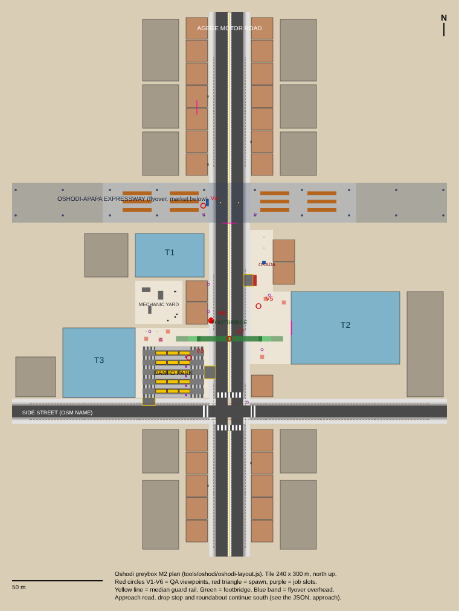

# M2 spec: Oshodi greybox (one Lagos street scene)

**Owner of the spec:** Claude (Oshodi workstream). **Builder:** Ted's team.
**Tasks:** M2.1 scene, M2.2 lighting and quality tiers, M2.3 streaming stub,
M2.4 Claude review (TASKS.md, M2 section). **Date:** 2026-11-05.
**Sources:** docs/DESIGN-INVENTORY.md section 1 (Oshodi identity, world rules,
budgets) and section 10 (streaming, B-35); docs/MIGRATION-PLAN.md section 6 M2;
browser lessons L-1, L-14, L-30, L-54, L-57 to L-61, L-64, L-84, L-125 and
docs/city-craft/human-scale.md in benjy659/naija-life (read-only reference).

**Plan picture:** [oshodi-greybox-plan.png](oshodi-greybox-plan.png) (SVG next to it).

---

## 0. The one rule for positions

Every position in this scene comes from **`docs/specs/oshodi-greybox-layout.json`**.
That file is made by **`node tools/oshodi/oshodi-layout.js`**, which also checks
the placement rules in section 9 and fails if one breaks. So:

- To move anything, change `tools/oshodi/oshodi-layout.js`, run it, commit the
  script, the JSON, the SVG and the PNG together. Never hand-edit the JSON and
  never move a thing only in the Unity scene.
- The Unity side reads the JSON with an Editor script (M2.1, section 8). The
  scene is built from the file, so the scene and the checked plan cannot drift.
- Units are metres. Axes: X east, Z north, Y up. A `rect` is `{x0, z0, x1, z1}`.
  `ry` is the Unity Y rotation in degrees (0 faces +Z, north; 90 faces +X, east).
- Levels: road top y 0.00, kerbs 0.12 high, pavements, plazas, park islands
  y 0.12.

This is the same idea as the browser rule "check every placed thing against the
roads" (L-30, L-54), moved to before the build instead of after it.

## 1. What the player must feel (acceptance in words)

Standing at the spawn on the west pavement and looking north, a Lagos player
must say "this is Oshodi" before anything moves: a wide road with a black and
white kerbed median and a guard rail, a steel footbridge overhead, yellow danfos
three deep in a park beside a curved-glass terminal, the Oshodi-Apapa flyover
ahead with a market and umbrellas underneath it, NEPA poles with sagging wires,
slab-covered gutters, posters on the pillars, hand-painted parody hoardings.
Nothing stands in a lane. Every pavement can be walked end to end. The footbridge
can be climbed and crossed on foot without a stumble.

## 2. The tile

- District tile `Oshodi_Core`, x -120 to 120, z -150 to 150 (240 by 300 m).
  Compressed for recognisability, not 1:1 (design inventory section 1): real
  names, game geography.
- One scene: `Assets/Scenes/Districts/District_Oshodi_Core.unity`, additive,
  loaded by `Bootstrap.unity` through Addressables (section 7).
- South of the tile, scene `Approach_South` carries Agege Motor Road on for
  650 m to a drop stop and a turning roundabout (section 4.6). It serves the M4
  conductor route and the streaming test.
- Tile edges: the roads carry on 10 m past the edge, then an invisible
  `PlayerBlocker` wall 4 m high; the skyline shell (section 6.5) fills the
  view beyond. The flyover deck runs past both edges into the skyline.

## 3. Roads, kerbs, pavements

### 3.1 ROAD-A, Agege Motor Road (north-south, x = 0)

| Part | x range (west / east) | Notes |
|---|---|---|
| Median | -1.05 to 1.05 | 2.1 m, raised 0.12, kerbs painted black and white (Lagos chequer), guard rail 1.2 m high on the centre line |
| Carriageway | -7.55 to -1.05 / 1.05 to 7.55 | 2 lanes of 3.25 m each way. Right-hand traffic: southbound on the west, northbound on the east |
| Kerb | -7.70 to -7.55 / 7.55 to 7.70 | 0.15 wide, 0.12 high |
| Pavement | -11.20 to -7.70 / 7.70 to 11.20 | 3.5 m (commercial). From the kerb: gutter slabs 0.6, furnishing zone 0.9 (poles, lamps, signs), clear zone 2.0 |
| Building line | at 11.2 | shophouses set back 1.0 m (front at 12.2); plazas start at 11.2 |

The median rail stops at the junction crossings only. It is there on purpose:
like the real road, people cross by the footbridge or at the junction.

### 3.2 ROAD-B, side street (east-west, z = -70)

1 lane of 3.25 m each way (z -73.25 to -66.75), kerbs 0.15, pavements 3.5 m both
sides with the same three zones. **Name:** take the real name of a side street
that meets Agege Motor Road by the interchange from OpenStreetMap and put it on
the street signs (lesson L-14, check names against the real thing). Until then
the signs say "SIDE STREET".

### 3.3 Junction, crossings, driveways

- Junction box x -7.55 to 7.55, z -73.25 to -66.75. No signals (real Oshodi);
  a LASTMA warden marker on the north-east corner for a later milestone.
- Zebra crossings, 3.0 m wide: across ROAD-A at z -62.5 to -59.5 and
  z -80.5 to -77.5; across ROAD-B at x -14.7 to -11.7 and 11.7 to 14.7.
  Dropped kerbs at both ends of each crossing.
- Driveways (dropped kerb, hatched apron, level for walkers):
  `drive-danfo-exit` (park to southbound ROAD-A, z -52 to -45),
  `drive-danfo-entry` (eastbound ROAD-B into the park, x -48 to -41),
  `drive-okada` (east plaza to northbound ROAD-A, z -1 to 5.5).

### 3.4 Gutters

The first 0.6 m of every pavement is a row of concrete slab covers over the
drain, flush with the pavement (walkable, no holes), with a visible joint every
1.0 m so it reads as slabs, not a stripe. Open gutters come later with water.

## 4. Structures and places

### 4.1 Terminals (curved glass)

| Id | Rect (x0, z0, x1, z1) | Height | Front |
|---|---|---|---|
| T1, Oshodi Transport Interchange Terminal 1 | -52, 4, -14, 28 | 12 m | east, curved glass, 3 bays |
| T2, Terminal 2 (largest) | 34, -44, 94, -4 | 16 m | west, curved glass |
| T3, Terminal 3 | -92, -62.5, -52, -24 | 10 m | east, faces the danfo park |

Greybox: a box with a curved glass front (ProBuilder arc, 6 to 8 segments), a
concrete band at each floor, the name on the front in a sign strip (text from
the table). Not enterable in M2 (interiors come later as additive scenes): the
ground-floor doors are dark recessed panels behind a 0.3 m step.

### 4.2 Footbridge (Terminal 3 plaza to Terminal 2 forecourt)

- Deck x -16 to 16, z -31.5 to -28.5 (3.0 m wide, it is meant to be full of
  people), top y 6.12, underside 5.72, steel parapets 1.1 m with banner panels.
  One span over the road and both pavements: no pier on a pavement or the
  median.
- Stairs at both ends run outward along X: top landing 2.0 m, flight of 18
  risers, mid landing 2.0 m, flight of 18 risers. Riser 0.167 m, tread 0.28 m,
  36 risers from plaza y 0.12 to deck y 6.12. West stair foot at x -29.52,
  east at 29.52; 3 m clear landing at each foot. Exact rects are in the JSON
  (`footbridge.stairs`).
- **Walkable:** each flight gets one smooth sloped BoxCollider (a ramp,
  about 31 degrees, layer `Ground`); the steps are visual only. The landings and
  deck are flat colliders. CharacterController step offset 0.3, slope limit 45
  must carry the player from plaza to deck and down the other side with no stop
  and no float (browser lessons: bridges must be walkable; feet on the deck, not
  under it).
- Under flight 2 and the mid landing the headroom drops below 2.1 m, so that
  part is closed underneath (solid box, `closedUnder` in the JSON). Under
  flight 1 is open.
- Piers: four 0.4 m square columns under the top landings at x -17 and 17, one
  poster each.

### 4.3 Flyover, Oshodi-Apapa Expressway (elevated, east-west)

- Deck z 34 to 56 across the whole tile, underside y 6.0, top y 7.2, parapet
  1.0 m. Three lanes each way painted on top, but the deck is **not reachable**
  in M2 (no ramps in this tile, nothing to climb). A blocker on top stops
  anything from landing there.
- Piers: 1.2 m round columns at z 38 and 52, x = plus or minus 14, 40, 66, 92,
  118. The piers at x plus or minus 14 carry two posters each, facing the
  pavement.
- Under the deck: the market (4.4), the OSHODI UNDER BRIDGE bus stop (4.5), and
  8 soffit lamps hung from the underside at y 5.7.

### 4.4 Under-bridge market

- Zones x -70 to -11.2 and 11.2 to 70, z 34 to 56.
- Three rows of stalls each side at z 41.0, 45.6, 50.2 (stall 2 by 2 m, table plus
  awning at 2.2 m); 8 stalls per segment in two segments per row (x 17 to 33 and
  43 to 59 from the road, both sides): 96 stalls. Aisles between rows 2.6 m
  (minimum 2.4). A 4.8 m frontage walk between the pavement and the first stall.
- Stall dressing (instanced): tables, stools, plastic basins, umbrellas, a
  bare bulb (emissive) on each awning.

### 4.5 Bus stop

OSHODI UNDER BRIDGE: shelter 1.6 by 4.0 m at (-12.2, 45), behind the west
pavement, open to the road; stop pole with the name board in the furnishing zone
at (-8.75, 42).

### 4.6 Danfo park (beside Terminal 3) and the M4 bays

- Pad x -48 to -14, z -62.5 to -34.25. Tail aisle x -48 to -41 (entry from
  ROAD-B), head aisle x -21.5 to -14 (exit to ROAD-A).
- Five loading lanes, 3.25 m wide, between six raised islands, 2.0 m wide,
  y 0.12, kerbed. Danfos stand **three deep** in each lane, noses east toward
  the exit: 15 parked danfos at x -24.75, -31.25, -37.75. The right-hand sliding
  door faces the island on the south side of each lane, which is the park's kerb.
- Route boards (2.6 m pole, yellow and black) at each island tip:
  OSHODI to UNILAG GATE, IKEJA ALONG, MILE 2, OBALENDE, IKOTUN.
- Painted walk crossings across both aisles at every island, a rail 1.1 m on the
  head-aisle edge (x -14) with gaps at the crossings and the exit driveway; the
  strip x -14 to -11.2 is a walkway.
- **M4 conductor bays** (jobs thread, docs/specs/jobs-m4.md section 6.4): bays 1 to
  3 are the M4 bays, 4 and 5 wait for later bots. Each bay in `danfoPark.bays`
  has: the danfo id, the door position, a `workPoint` on the island at the door,
  two `asidePoints` 2.3 to 2.5 m from the door (one each way along the island;
  the bot uses the one farther from where the player stepped onto the island,
  so it is never between the player and the door), and six `queue` spots
  0.8 m apart for waiting passengers.
- **Drop stop and turning point** (Approach_South): ROAD-A continues south.
  A 3.0 m lay-by on the southbound (right-hand) side at z -655 to -637, stop
  point at z -646 (597.5 m from the park exit), alight point on the pavement,
  shelter behind the pavement. A roundabout at z -720 (island radius 9, ring
  7 m) is the turning point for the out-and-back. Use the real name of the next
  stop south of Oshodi on Agege Motor Road from OSM for the board.

### 4.7 Okada park and east plaza

Four okadas angled 45 degrees at x 14.0, z 0 to 4.2, rider slot markers beside
them, the `drive-okada` driveway to the road. POS kiosk at (19, 12). Two almond
trees at (19, 20) and (19, 26).

### 4.8 Shophouses, yard, filler

- Shophouses, 2 to 4 storeys (7, 10, 13 m), in 12 m frontages along both sides
  of ROAD-A north of the flyover and south of ROAD-B, plus four in the middle
  (ids in the JSON). Ground floor: a dark shopfront opening with 1.7 m double
  doors, a roller-shutter box above, a painted signboard. Upper floors: window cards
  (emissive at night, random 40% lit).
- Back rows and far filler are plain boxes in one shared material to frame the
  street.
- Mechanic yard (x -52 to -26, z -22 to 2): three car shells, tyre stacks,
  one generator.

## 5. Props (full list in the JSON)

| Type | Count | Where and rules | Collider, layer |
|---|---|---|---|
| NEPA pole 9 m, cross-arm, insulators | 34 | furnishing zone of every pavement, about every 30 m; never under the flyover or footbridge | capsule, Prop, instanced |
| NEPA wires | 26 spans, 3 strands | pole to pole on the same run, top 8.6, sag to 7.4; never through the flyover or footbridge | none, CameraIgnore, one merged mesh |
| Street lamp 9 m, 2.5 m arm over the road | 30 | furnishing zone, offset 15 m from the poles | capsule, Prop, instanced |
| Soffit lamp | 8 | under the flyover deck, y 5.7 | none |
| Median guard rail | 2 runs | ROAD-A median | box, Prop |
| Stalls | 96 | under-bridge market | box, Prop, instanced |
| Umbrellas (red, blue, Lagos-yellow) | 6 | plazas only | pole capsule only; canopy on CameraIgnore |
| Hawker slot markers | 8 | plazas and the under-bridge frontage | none, Marker (M4) |
| Bus shelter and stop pole | 1 each | section 4.5 | box / capsule |
| Street name signs (green and white) | 3 | junction corners, furnishing zone | capsule |
| Generators | 6 | 1.0 m setback strip by shop fronts, yard | box, Prop, also a noise source |
| POS kiosk | 1 | east plaza | box |
| Car shells, tyre stacks | 3, 3 | mechanic yard | box / capsule |
| Almond trees | 5 | plazas only, none by the road | trunk capsule |
| Hoardings (parody brands only) | 3 | NAIJA COLA on Terminal 2 roof, KUDI BANK on the flyover's south face, WAZO MOBILE on a north-west roof; each lists where its reader stands (L-60) | none |
| Posters | 2 per flyover pier at x plus or minus 14, 1 per footbridge pier | 0.02 m off the face (no z-fight) | none |

Brands: parody names only, never a real company name or logo (browser L-22).
No real political party names, colours or faces anywhere (owner rule).

## 6. Lighting, time of day, quality tiers (M2.2)

### 6.1 Time of day

**Status 2026-11-06:** Claude wrote the M2.2 code (commit 8d3f39c):
`Assets/Scripts/World/TimeOfDay.cs`, `LampLightPool.cs`, the URP tier assets
`Assets/Settings/URP_Low|Medium|High.asset` set to the 6.4 table and wired
into each quality level. Bloom (a Volume) is Ted's Editor step; the skyline
shell (6.5) is not built yet. Never compiled: UNVERIFIED until Ted's run
(inbox IN-17).

- `TimeOfDay` component in Bootstrap. Default source: real WAT
  (UTC plus 1, `DateTime.UtcNow.AddHours(1)`, works in WebGL). For M2 the sun
  table is fixed: sunrise 06:30, sunset 18:30 WAT; the real table comes later.
- QA override: a debug menu (development builds only) with 07:00, 13:00, 17:30,
  21:00 presets. No key that is also a game control.
- Weather: clear only in M2. Live weather comes later (owner rule: live weather
  always wins).

### 6.2 Day

- One Directional Light (sun), colour and angle from a gradient over the day,
  noon intensity about 1.2. Realtime, mixed lighting off, no baked GI in M2.
- Environment lighting: gradient (sky, equator, ground), warm in the day.
- Lagos haze: linear fog, start 80 m, end 380 m, warm grey in the day,
  deep blue at night. The skyline shell sits inside the fog end so it reads as
  haze, not a hard edge.
- One baked reflection probe (box) at the terminals for the glass.

### 6.3 Night

- Street lamps: emissive heads always; a pool of real point lights (range 18 m)
  moves to the nearest lamps around the player. Pool size by tier: Low 4,
  Medium 6, High 8 (same budget as the browser light rule: 8 point lights at
  most).
- Soffit lamps and stall bulbs: emissive only, no real lights.
- Terminal glass and upper-floor windows: emissive at night (random 40% of
  windows lit, fixed seed so it does not flicker between loads).
- Night must stay readable at 390 by 844: player and kerbs visible, nothing
  pitch black (check at V6).

### 6.4 URP quality tiers (Low, Medium, High; WebGL default Medium)

| Setting | Low | Medium | High |
|---|---|---|---|
| Render scale | 0.75 | 0.9 | 1.0 |
| MSAA | off | 2x | 4x |
| Main light shadows | off | hard, 1 cascade, 40 m | soft, 2 cascades, 70 m |
| Additional lights per object | 4 | 6 | 8 |
| Lamp light pool | 4 | 6 | 8 |
| Bloom | off | on, low | on |
| SSAO | off | off | off (WebGL cost; revisit at M6) |
| Fog | on | on | on |
| Dynamic resolution | on | on | on |
| LOD bias | 0.7 | 1.0 | 1.5 |

### 6.5 Skyline shell

One mesh (one draw call) ring of flat building silhouettes at about 350 m, with
a cluster of glass towers to the south-east (Victoria Island across the water,
lit windows at night). Never collides, layer `CameraIgnore`.

## 7. Streaming stub (M2.3, start of B-35 in Unity)

**Status 2026-11-06:** Claude wrote the M2.3 code (commit 8d3f39c):
`DistrictTile.cs`, `DistrictStreamer.cs`, `FrameSpikeLogger.cs` in
`Assets/Scripts/World/`, and `Assets/Editor/World/OshodiBootstrapSetup.cs`
(menu Naija Streets > Set up Oshodi streaming (Bootstrap)), which makes the
Addressables group, the tile asset and `Assets/Scenes/Bootstrap.unity`.
Approach_South loads from Build Settings before the player is switched on.
Never compiled: UNVERIFIED until Ted's run (inbox IN-17).

- `Bootstrap.unity`: player, camera, TimeOfDay, `DistrictStreamer`, debug
  overlay, and `Approach_South` (always loaded in M2).
- Addressables group `District_Oshodi` (local in M2, remote CDN later) holds
  `District_Oshodi_Core.unity`.
- `DistrictTile` ScriptableObject: id, scene address, bounds rect (the tile),
  wake distance 600 m, sleep distance 700 m (100 m of hysteresis so it never
  loads and unloads on one line).
- `DistrictStreamer` checks the player's distance to each tile's bounds every
  0.5 s. Inside wake: `Addressables.LoadSceneAsync(address, Additive)`.
  Outside sleep: `Addressables.UnloadSceneAsync`. One load at a time. Shows
  state and load time on the debug overlay.
- WebGL is single-threaded, so the scene must be light to activate: static
  batching baked at build time (never `StaticBatchingUtility.Combine` at run
  time), no `Start()` that builds geometry, props are prefab instances.
- `FrameSpikeLogger` (development builds): records the worst frame time in a
  10 s window around each load and unload, shows it on the overlay, logs it.
  **Budget: no frame over 200 ms** entering the district.
- Test: start at `approach.streamingTestStart` (z -790, 640 m from the tile,
  tile asleep), walk north. The tile wakes at 600 m and is in before the player
  can see that far (fog end 380 m). Walk back south past 700 m: it unloads.

## 8. How the scene is built (M2.1)

**Status 2026-11-06:** Claude wrote items 1, 3 to 6 below as code:
`Assets/Editor/World/OshodiGreyboxBuilder.cs` (+ `OshodiGreyboxData.cs`, asmdef
`NaijaLife.World.Editor`) and `Assets/Tests/EditMode/World/OshodiGreyboxTests.cs`
(asmdef `NaijaLife.World.Tests`). The builder reads
`Assets/Data/Oshodi/oshodi-greybox-build.json`, a flat list of greybox pieces
made from the layout by `tools/oshodi/oshodi-build-list.js` (run automatically
by `node tools/oshodi/oshodi-layout.js`). It uses Unity primitives with one URP
Lit material per palette colour instead of prefabs (item 1 and 2 below), which
is enough for a greybox; prefabs come with the art pass. The core scene also
gets an `Oshodi_Playtest` root (sun, camera, Player prefab at the spawn,
PlayerCamera) so it can be played on its own. Never compiled yet: UNVERIFIED
until Ted's team runs it (TASKS.md M2.1, inbox IN-14).

1. `Assets/Editor/World/OshodiGreyboxBuilder.cs`: menu item "Naija Streets/Build
   Oshodi greybox". Reads the JSON, deletes and rebuilds the generated root
   `Oshodi_Generated` in the open scene (idempotent; never touches hand-made
   objects outside that root). Roads, kerbs, pavements, plazas as meshes made
   from the rects; buildings and props as prefab instances from
   `Assets/Prefabs/World/Greybox/<type>.prefab`; every object named by its JSON
   id (so a check can say whose it is, L-53).
2. Greybox materials: one flat colour each, URP Lit, GPU instancing on, SRP
   Batcher compatible, a shared trim atlas for signs and posters. Danfo yellow
   with the two black stripes, okadas red, terminals blue-grey glass.
3. Layers: `Ground` (road, pavements, plazas, islands, stair ramps, deck),
   `Building`, `Prop`, `CameraIgnore` (umbrella canopies, wires, signs,
   hoardings, posters, skyline), `PlayerBlocker`, `Marker`. The camera occlusion
   mask is Ground plus Building plus Prop (large only). Static flags on
   everything that never moves.
4. Colliders: primitives only on props (box, capsule). Buildings get a box that
   matches the footprint, never a plot-sized box (L-59). The roundabout island
   gets a cylinder (L-125). No collider on any walkable top other than the
   ground layer pieces above.
5. Job slot and view markers: empty GameObjects named by id with a gizmo, so
   M4 and QA can find them (`slot-conductor-1`, `bay-1/workPoint`, `V1` and so
   on).
6. Edit-mode tests (Unity Test Framework, `Assets/Tests/EditMode/World/`):
   - `LanesAreClear`: for every lane rect, cast a 0.45 m capsule along its
     centre line every 1 m at y 0.9; zero hits allowed except overhead
     structures above 5.5 m. Report the id of every blocker.
   - `PavementsAreWalkable`: same along the middle of every clear zone.
   - `FootbridgeIsWalkable`: drive a CharacterController from the west stair
     foot to the east stair foot along z -30 in 0.1 m steps with
     `Move()`; it must arrive, never step more than 0.3 m, never fall.
   - `SceneMatchesLayout`: every JSON id exists in the scene at its position
     (within 1 cm) and rotation.
   These run in batch mode, so they also run in CI later.

## 9. Placement rules (checked by the script, then by the Unity tests)

`node tools/oshodi/oshodi-layout.js` fails if any of these break:

1. Nothing at ground level stands in a lane or the junction; props keep 0.75 m
   from every lane edge. Overhead things count only if their underside is at
   or above 5.5 m.
2. Nothing solid stands in a pavement clear zone (2.0 m always free).
3. Buildings stay off roads, kerbs, pavements, driveways, plazas, the park and
   the footbridge, never overlap each other, never rise into the flyover.
4. Props are never inside a building, a driveway, a crossing, the park pad or a
   stair.
5. Footbridge and flyover undersides are at least 5.5 m over the road. Piers
   stand off roads and pavements and 0.75 m from lanes.
6. The footbridge spans both pavements; both stair feet land on open plazas;
   risers 0.15 to 0.18, treads 0.25 to 0.30, ramp slope under 40 degrees; the
   chained climb has no step over 0.3 m and meets the deck; the low-headroom
   part under each stair is closed.
7. Danfos sit inside their loading lane with at least 0.5 m each side; conductor
   slots are on islands.
8. Market aisles at least 2.4 m; stalls stay 0.6 m off the piers and inside the
   market zones.
9. NEPA wires never pass through the flyover or footbridge.
10. Spawn and every viewpoint stand on a walkable surface, not in a building.
11. M4 bays: work, aside and queue points on the island with 0.3 m to spare,
    aside points 2 to 3 m from the door, 6 queue spots, all at least 0.75 m
    apart; at least 3 bays.
12. Approach road: drop stop about 600 m from the park, lay-by outside the
    through lane, shelter off the pavement, roundabout ring at least 6.5 m,
    streaming test start more than 600 m from the tile.
13. Draw call estimate under 100.

Current run: PASS (45 buildings, 211 props, 15 danfos, 26 wire spans, estimate
69 draw calls).

## 10. Budgets

| Budget | Limit | How it is checked |
|---|---|---|
| Draw calls in view (Stats window "Batches") | under 100 at V1 to V6, Medium tier | screenshot of Stats at each viewpoint |
| Draw calls, whole district loaded | 350 at most (150 of it kept for M3 traffic and M4 people) | Frame Debugger, top view |
| Triangles in view | 300k (Low, phone) / 500k (High) | Stats |
| Frame time | 60 fps target on a mid-range laptop (WebGL High); 30 fps at 390 by 844 (real phone check by Benjamin) | dev build overlay |
| Load spike | no frame over 200 ms entering the district | FrameSpikeLogger |
| Memory | Oshodi tile under 60 MB loaded (greybox textures are few and small) | Memory Profiler snapshot |
| Download | the whole WebGL build stays under 50 MB compressed | build report |

Estimate breakdown (in the JSON `budgets.drawCallBreakdown`): road and markings
2, kerbs and median 2, pavements 2, plazas 1, terminals 2, shophouses and filler
3, signs and posters 2, flyover 2, footbridge 2, danfos 2, okadas 1, poles and
wires 2, lamps 2, rails 1, market 4, other furniture 3, trees 2, skyline 1, sky
1, player 3, shadow casters 25, HUD 4: 69.

## 11. QA evidence Ted's team posts (under qa/M2.1/, qa/M2.2/, qa/M2.3/)

Nothing in M2 is DONE on code review. Claude verifies from these files (the
cloud cannot run Unity):

1. `node tools/oshodi/oshodi-layout.js` output (PASS) and the Unity Test Runner
   result for the four edit-mode tests.
2. Screenshots at every viewpoint V1 to V6 (positions and times in the JSON),
   in a WebGL build, at 390 by 844 and 1280 by 800, with the Stats window or the
   dev overlay showing draw calls and fps. QA walks the player to each spot
   (L-57, never teleport); a camera-only frame is labelled as such.
3. A short clip (30 s) walking from the spawn up the west stair, across the
   deck and down the east stair, phone width.
4. M2.2: V1 and V6 at Low, Medium and High.
5. M2.3: the overlay during the streaming test (state, load ms, worst frame).
6. A REPORT.md with what was checked and anything UNVERIFIED.

Before calling a shot done, read each noun of section 1 against the frame
(L-58): wide road, median rail, footbridge, danfos three deep, curved glass,
flyover, market, umbrellas, NEPA wires, gutter slabs, posters, hoardings.

## 12. Not in M2 (later milestones)

Traffic, walking people and bots (M3, M4); driving on the roads (M3); entering
terminals and shops (interiors); the Red Line station and rail corridor (check
which side of the road it runs on in OSM first); the second footbridge; flyover
ramps; real weather and the real sun table; GLB art pass to replace the greybox
(budgets: landmark 50k triangles, filler 8k, textures 1024 px).
